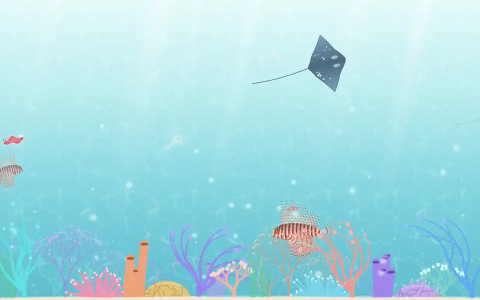
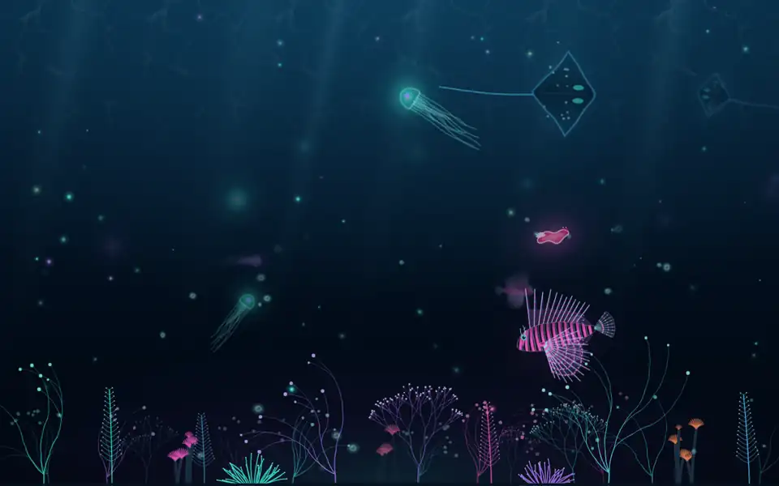
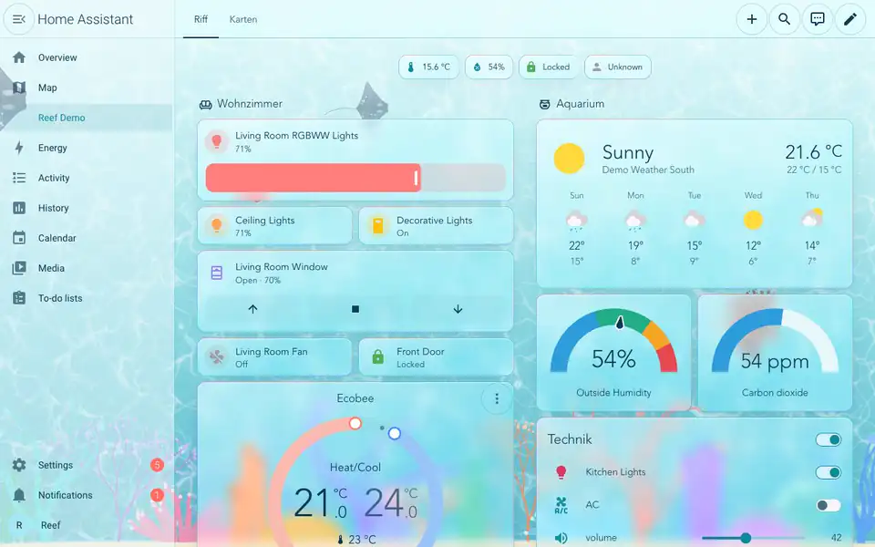
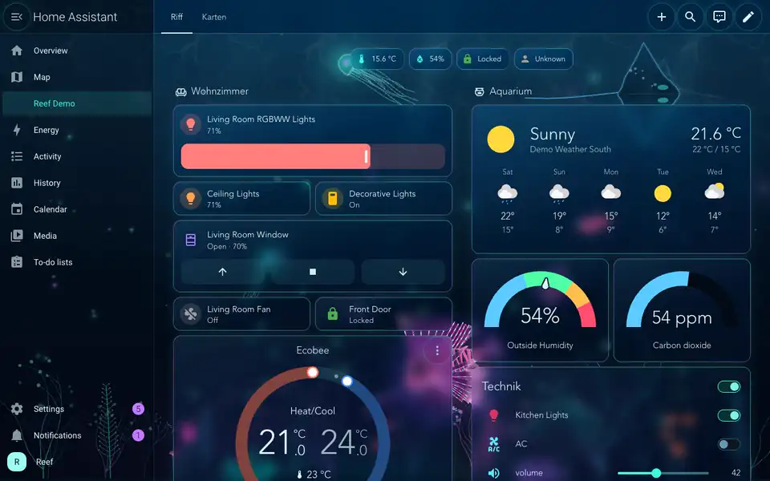
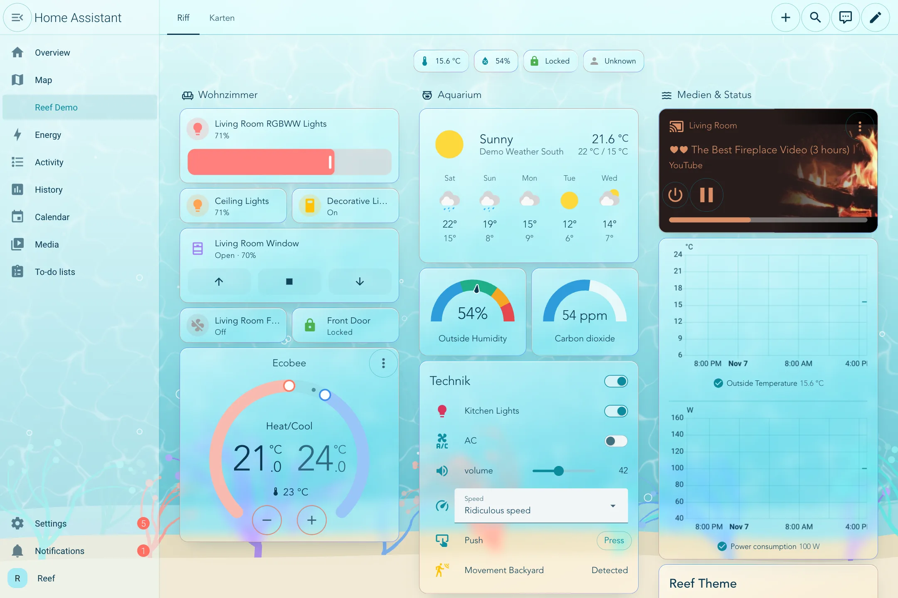
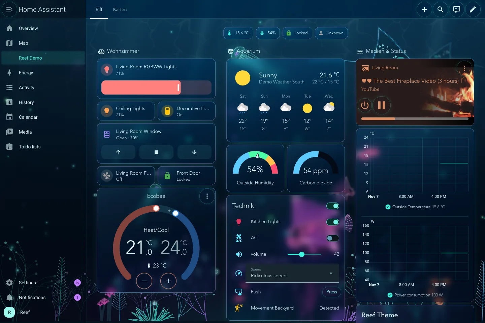
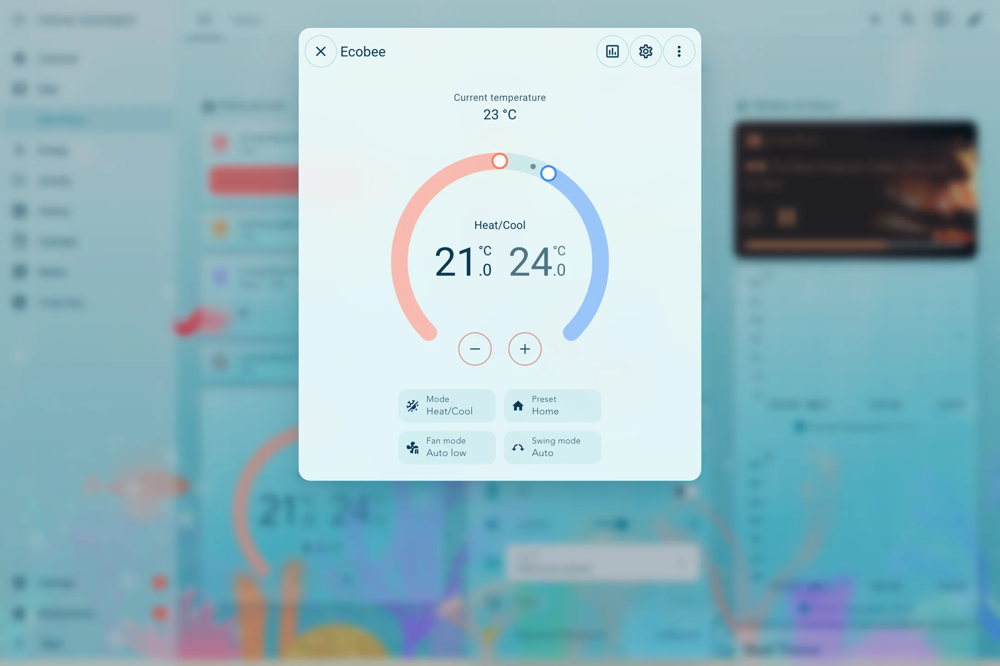
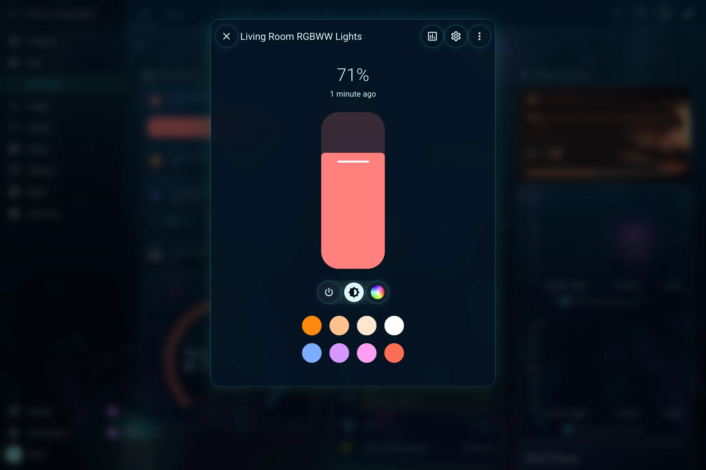
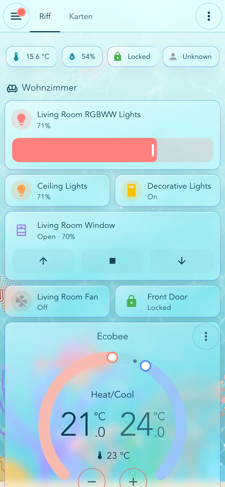
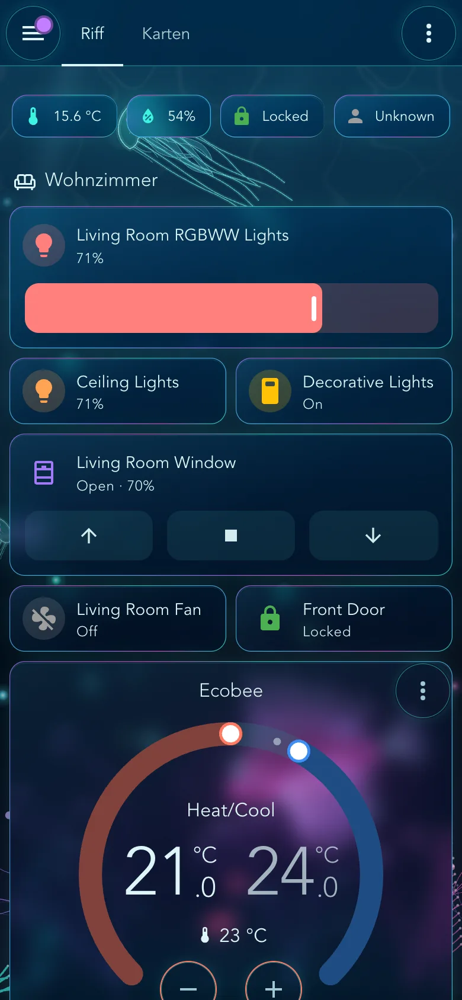

# Reef Theme

A water theme for Home Assistant: frosted-glass cards, hairlines in the colours of the reef, and a background that shimmers like light under water.

I love the sea and the underwater world, hence the theme. 🙂

| Reef Coral (light) | Reef Abyss (dark) |
| --- | --- |
|  |  |
|  |  |
|  |  |
|  |  |

<p align="center">
  
  &nbsp;&nbsp;
  
</p>

## Themes

The file has three themes:

| Theme | Mode | Look |
| --- | --- | --- |
| **Reef** | Follows the light/dark setting of your profile or device | Reef Coral by day, Reef Abyss by night |
| **Reef Coral** | Always light | A sunlit coral reef: turquoise water, light shafts, caustics, corals on white sand |
| **Reef Abyss** | Always dark | The deep sea: almost black water, bioluminescent plankton and glowing neon tendrils |

## Features

- **Works with the built-in cards and pages.** The theme sets the classic variables and the newer `ha-color-*` design tokens, with a full primary palette. Tiles, badges, buttons, sliders, switches, dialogs, inputs, the sidebar, the header, and the settings pages all take on the theme.
- **Gradient hairlines.** Every card and badge gets a 0.5 px line with a colour gradient (cyan, blue, violet, coral) that slowly turns and shifts its colours. The header, dialogs, and buttons get a hairline in the colour of the theme.
- **Glass everywhere.** Cards, badges, the sidebar, the header, the toolbars of the settings pages, and dialogs are translucent, with a backdrop blur. The underwater scene sits behind every panel, so the glass works on dashboards, in the settings, and behind the sidebar.
- **A living background.** Shimmering caustics in three layers, flickering light shafts and glowing air bubbles. It is one self-contained SVG, built into the theme file: nothing to copy to `www/`, no external requests, no custom cards, no card-mod.
- **Animals.** Jellyfish with a pulsing bell, frilly oral arms and long trailing tentacles; a lionfish with wavy bands that curve around its eye, fringed tentacles on its face, feather-like pectoral fins that open and close slowly like a fan while a wave flows through them and their blades curl like the hem of a dress, flexing dorsal spines with billowing sails between them, and a mystic aura that breathes with its fins; an eagle ray (a manta in the deep) gliding with slow, deep wing beats; and a Spanish dancer rolling its red mantle. They swim along random paths in every direction and at different depths: far away they are small, faint, blurred and slow, close by big, sharp and fast. Their glow pulses with their movement.
- **A reef from the very bottom.** Sea fans, staghorn and brain corals, tube sponges, anemones with waving tentacles and sea grass in Reef Coral; glowing sea pens, tube worms that pull in their crowns, neon anemones and sea fans in Reef Abyss.
- **Fine and modern.** Light font weights (Avenir Light on Apple devices, Segoe UI Variable on Windows, Roboto as fallback), corners with a 13 px radius, quiet shadows.

<!-- ha-marketplace:exclude-start -->
## Installation

### Marketplace (Home Assistant 2026.11 and later) or HACS

[](https://my.home-assistant.io/redirect/hacs_repository/?owner=benkrebs&repository=reef-theme&category=theme)

1. Select the badge, or open **Settings** > **Marketplace** (HACS before 2026.11) and add `https://github.com/benkrebs/reef-theme` as a custom repository of the type **Theme**.
2. Install **Reef Theme**. The Marketplace reloads the themes by itself.

### Manual

1. Copy [`themes/reef.yaml`](themes/reef.yaml) to `themes/reef/reef.yaml` in your configuration folder.
2. Run the `frontend.reload_themes` action, or restart Home Assistant.
<!-- ha-marketplace:exclude-end -->

## Use it

1. Make sure `configuration.yaml` loads the `themes` folder. Home Assistant adds this line when it creates the file, but older setups may lack it:

   ```yaml
   frontend:
     themes: !include_dir_merge_named themes
   ```

2. Open your **profile** and pick **Reef**, **Reef Coral**, or **Reef Abyss** under *Theme*. With **Reef**, the *Dark mode* setting next to it switches between the two looks.

You can also set the theme on one dashboard view only, with `theme: Reef Abyss` in the view configuration.

## Performance

The background and the hairlines animate with SVG (SMIL), drawn by the browser. Phones, tablets, and computers from the last years handle it without trouble. Very weak wall tablets may stutter: the animation is part of the theme and can not be turned off per device.

The theme file is about 800 KB, because the backgrounds are built into it (once per theme). Home Assistant sends it compressed, about 200 KB, once per connection.

## Companion apps

The Home Assistant apps show the same frontend in a web view: the iPhone, iPad and Mac app use Apple's WKWebView (WebKit, the engine of Safari), the Android app uses Android System WebView (Chromium). The background is an animated SVG image that uses only transform, opacity and motion animations, which both engines support.

If the background stands still in the app:

- **iPhone and iPad:** turn on *Settings* > *Accessibility* > *Motion* > *Auto-Play Animated Images*. With it off, WebKit pauses all animated images, in Safari and in apps. Low Power Mode can pause them too.
- **Mac:** the same switch is in *System Settings* > *Accessibility* > *Display* > *Auto-play animated images*.
- **Android:** update *Android System WebView* in the Play Store.

## Customize

`themes/reef.yaml` is generated. To change colours, the background, or the strength of the glass, edit [`tools/build.py`](tools/build.py) and run:

```sh
python3 tools/build.py      # writes themes/reef.yaml and previews in assets/
python3 tools/validate.py --check-build   # checks the file like Home Assistant does (needs PyYAML)
```

The background previews are in [`assets/`](assets/): open them in a browser to see the animation.

## Compatibility

Needs Home Assistant 2026.11 or later: the theme puts the background behind all panels with `ha-panel-background`, which older versions don't draw everywhere. Tested with 2026.11.0.

## License

[MIT](LICENSE)
